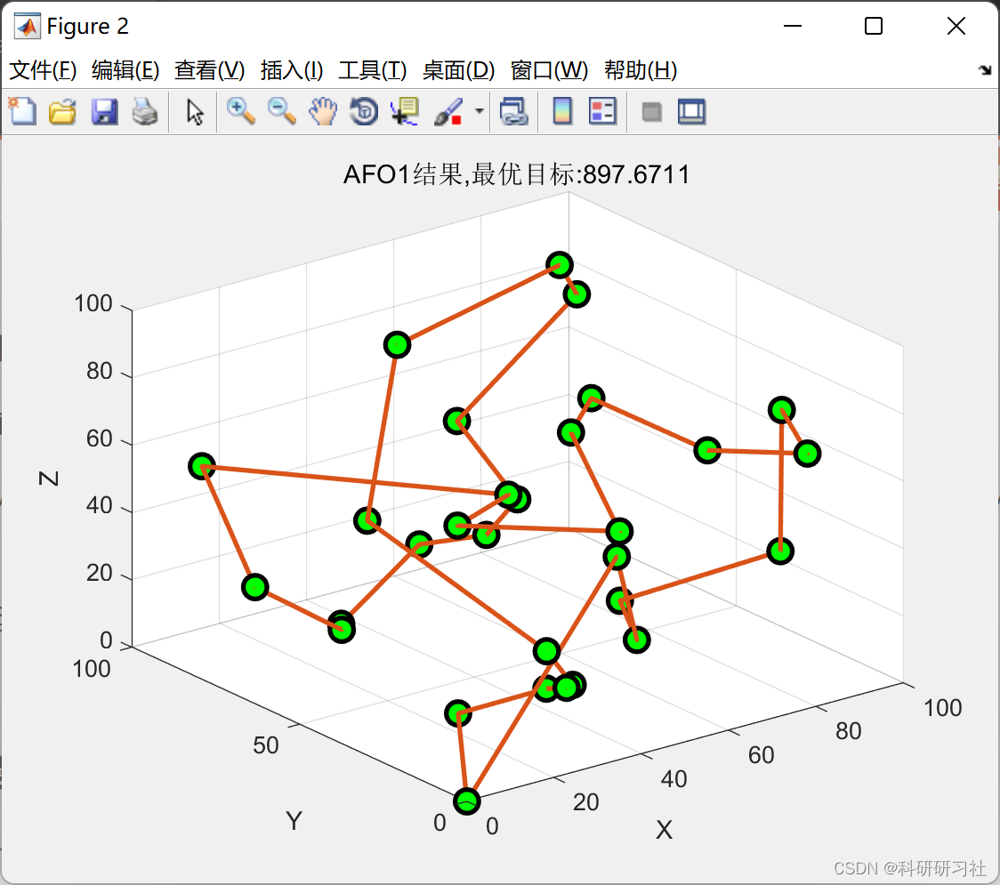
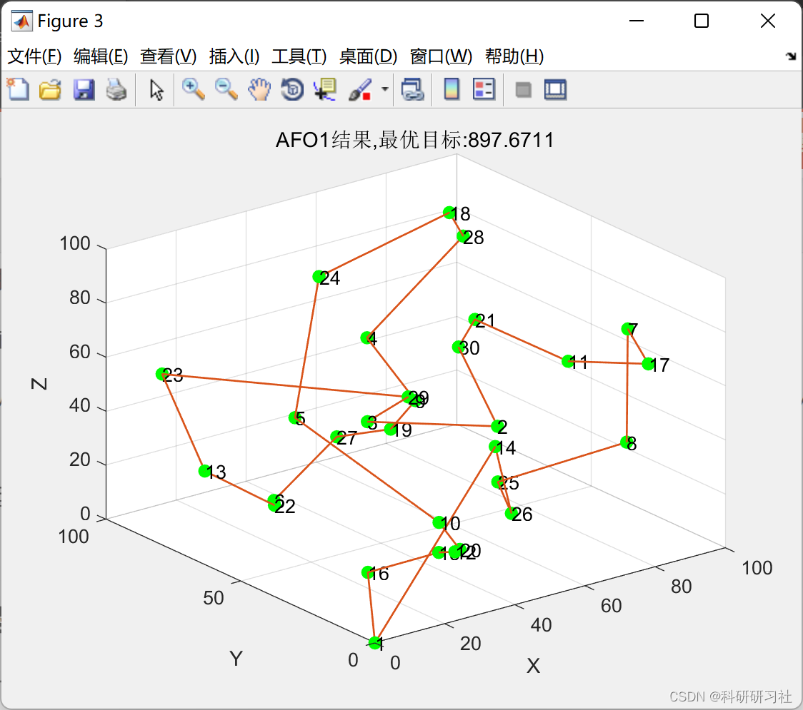
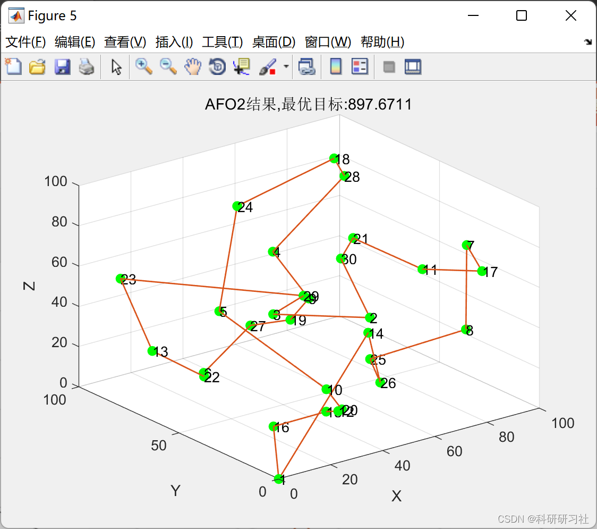

# Robot Trajectory Planning Based on Penguin Optimization Algorithm (Matlab Code Implementation)

​  
1. Overview
Currently, the problem of trajectory planning for robots remains a significant research topic in the field of artificial intelligence. Most industrial machines still operate on serial nonlinear spatial linkage mechanisms, which impose numerous constraints on the structure and joint torques, as well as rotational angles of the robot. To maximize the driving capabilities of industrial robots and achieve efficient work, according to the characteristics of robot trajectory planning, it is often necessary to consider speed, acceleration, and operational time in most cases. However, the structural limitations, rotational angles, and joint torques of the robot necessitate that when controlling the robot to move to a pre-set motion point, it must follow the planned trajectory [59].It is noteworthy that in general, robot trajectory planning has strict requirements for positioning and speed. The velocity and acceleration of the moving joints are set to their maximum values to constrain them, thereby avoiding overload conditions [60].
The principle of robot trajectory planning is to convert Cartesian coordinate point paths into joint angle values in the spatial coordinate system using inverse kinematics. The path points are fitted with interpolation curves, and time planning is performed on these interpolated points. Through sorting of these points and real-time recording of the robot's movement parameters at various locations, real-time control is achieved through receiving feedback signals in real time.
(1) The robot aims to minimize energy consumption throughout the entire motion process, i.e., trajectory optimization with minimum energy consumption.
(2) The motion path of the robotic arm from the initial point to the designated target point is shortest, and the relative motion time is shortest, which is the goal of time minimum trajectory optimization.
(3) The objective is to minimize the impact or influence on speed during movement, which is known as the minimum impact trajectory optimization.
(4) Considering multiple aspects such as energy consumption, time, and impact velocity, i.e., multi-objective comprehensive trajectory optimization;
2 Mathematical Model
For detailed mathematical models, refer to Part 4.
3. Running Results Editing
Editor
Editor
4. Matlab code and detailed article. This article only displays a part of the code, all code and detailed articles can be found in:
function drawPc(result1,option,data,str)\nfigure\nplot3(data.node(:,1),data.node(:,2),data.node(:,3),'o','LineWidth',2,...\n    'MarkerEdgeColor','k',...\n    'MarkerFaceColor','g',...\n    'MarkerSize',10)\nhold on\nplot3(data.node(result1.path,1),data.node(result1.path,2),data.node(result1.path,3),'-','LineWidth',2,...\n    'MarkerEdgeColor','k',...\n    'MarkerFaceColor','g',...\n    'MarkerSize',10)\nxlabel('X')\nylabel('Y')\nzlabel('Z')\ngrid on\ntitle([str,'Result,Optimal objective:',num2str(result1.fit)])\nfigure\nplot3(data.node(:,1),data.node(:,2),data.node(:,3),'o','LineWidth',2,...\n    'MarkerEdgeColor','g',...\n    'MarkerFaceColor','g',...\n    'MarkerSize',5)\nhold on\nplot3(data.node(result1.path,1),data.node(result1.path,2),data.node(result1.path,3),'-','LineWidth',1,...\n    'MarkerEdgeColor','g',...\n    'MarkerFaceColor','g',...\n    'MarkerSize',5)\nfor i=1:length(data.node(:,1))\n    text(data.node(i,1),data.node(i,2),data.node(i,3),num2str(i))\nend\nxlabel('X')\nylabel('Y')\nzlabel('Z')\ngrid on\ntitle([str,'Result,Optimal objective:',num2str(result1.fit)])\nend\n  
5. References
[1] Lü Jinlong, Wang Keshuai. Analysis of trajectory planning for package robots based on improved ant colony algorithm [J]. China New Technology and New Products, 2021(24): 23-25. DOI: 10.13612/j.cnki.cntp.2021.24.009.

## Images

<!-- PAYMENT_BLOCK -->

## Get this dataset

- Payment link (Stripe): [Buy now](https://buy.stripe.com/3cs8yP7sY87d0vu9AB)
- Payment QR code: 

<!-- /PAYMENT_BLOCK -->
